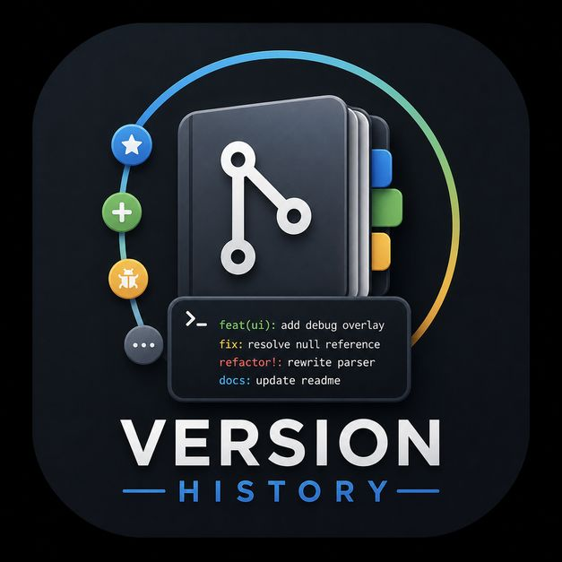
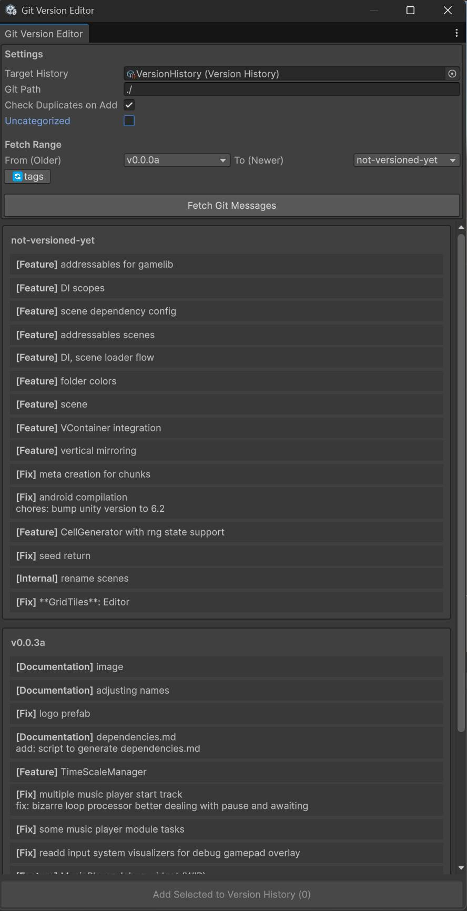

# GameLib Version History Module

An automated pipeline for Unity that extracts Git commit history, parses Conventional Commits, and safely bridges repository data into both **Runtime Assets** (for in-game debug overlays) and **Markdown** (for standard release notes).

Designed with strict Editor/Runtime separation, non-blocking asynchronous execution, and a powerful "fetch, pool, and curate" workflow that gives you total control over what makes it into your final changelog.

---

## 🌟 Key Features

* **Strict Separation of Concerns**: Editor settings and Git processing never leak into the game build. Runtime assets (`VersionHistory`) contain purely uncoupled data.
* **Curated Git Pooling**: Commits are fetched into a temporary in-memory pool, grouped by version tags. You choose exactly which commits are added to the official history.
* **Non-Blocking Git Execution**: Uses native C# asynchronous background processes (`UniTask`) to fetch massive Git histories without freezing the Unity Editor.
* **Range Fetching & Multi-selection**: Fetch specific spans of history using bounding tags. Effortlessly select ranges of commits using standard OS-style Shift/Ctrl clicking. 
* **Conventional Commits Native**: Regex-based parser accurately detects commit scopes `feat(ui):`, breaking changes `refactor!:`, and maps them to human-readable categories.

---

## 🏗 Architecture & Components

The module is divided into two distinct assembly layers to protect your build size:

### 1. Runtime Layer (`GameLib.VersionHistory.Runtime`)
* **`VersionHistory`**: A simple, pure-data `ScriptableObject` containing versions and their changes. This is the only file that gets included in your final game build. 

### 2. Editor Layer (`GameLib.VersionHistory.Editor`)
* **`VersionHistoryEditorWindow`**: The central IMGUI curation hub. It fetches logs via Git, checks for exact-string duplicates, handles uncategorized commits, and injects selected items into your `VersionHistory` asset.
* **`VersionHistoryExporter`**: A 1:1 configuration asset tied to a specific `VersionHistory`. It manages formatting overrides (like limiting output to the last X versions) and writes the final `.md` file to disk.

---

## 🚀 Setup & Usage

### Step 1: Create the Data Asset
1. Right-click in your project window: `Create > GameLib > VersionHistory > Version History`.
2. Name the file (e.g., `AppVersionHistory`). This is the asset your in-game UI will read from.

### Step 2: Curate Git History
1. Select your `VersionHistory` asset and click the **"Edit with Git"** button in the inspector (or open it via `Window > GameLib > Version History Editor`).
2. Set your **Git Path** (e.g., `./` for the root project, or a specific submodule path) and drop your target history into the object field.
3. Configure your **Fetch Range** to limit how far back Git parses.
4. Click **"Fetch Git Messages"**.
5. Your commits will appear grouped by their version tags. Shift-click or Ctrl-click to select the relevant commits, and click **"Add Selected to Version History"**. The tool will automatically prevent duplicate entries.

### Step 3: Export to Markdown
1. Create an exporter asset: `Create > GameLib > VersionHistory > Exporter`.
2. Assign your `VersionHistory` asset to the **Target History** field.
3. Configure your export options:
   * **Asset Name**: The desired file name (e.g., `CHANGELOG`). It will automatically save to the same directory as the Exporter asset.
   * **Include All**: Check this to bypass individual "IsIncluded" toggles.
   * **Take Only Last X Versions**: Set to `N` to clip old history, or `0` for everything.
4. Click **"Export Markdown"** at the bottom of the inspector.

---

## 📝 Commit Mapping Rules

The parser follows strict [Conventional Commits](https://www.conventionalcommits.org/). Commits are automatically grouped in the UI according to these rules:

| Commit Keyword | Mapped Category | Notes |
| :--- | :--- | :--- |
| `feat` / `added` | **Features** | Minor version bump. |
| `fix` / `bugfix` | **Bug Fixes** | Patch version bump. |
| `perf` | **Performance** | Performance optimizations. |
| `!` or `BREAKING CHANGE` | **Breaking Changes** | Major version bump. Bypasses base type. |
| `docs` | **Documentation** | |
| `build` / `ci` | **Build & CI** | |
| `chore`, `refactor`, `style` | **Internal** | *Auto-excluded* by default to reduce noise, unless explicitly toggled on. |
| *No Prefix* | **Uncategorized** | Basic commits (like "Initial commit"). Can be optionally included via the Editor window settings. |